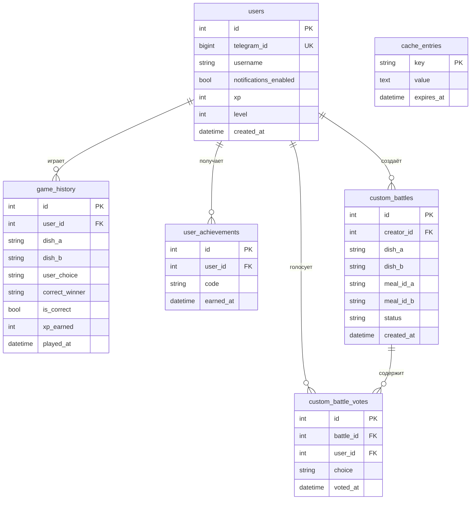

# Кулинарная Битва (Culinary Battle)

Telegram-бот, тема №13 «Кулинарный батл». Бот показывает два блюда, а игрок угадывает,
какое из них популярнее. За ответы начисляются XP, уровни и бейджи, а для блюда-победителя
можно открыть рецепт с калорийностью и видео. Игрок также может создать свой «бой» и
отправить друзьям на голосование.

Бот: https://t.me/CulinaryBattle2026_bot

Автор: Гайдучик Богдан, группа: 141-ПМо

## Возможности

- **Игра «Угадай популярность»**: два блюда, выбор inline-кнопками, разбор результата.
- **Рецепт победителя**: фото, ингредиенты, шаги, видео-инструкция, калорийность.
- **Бои для друзей**: свои пары блюд, ссылка-приглашение (deep link), один голос на человека,
  завершение боя и рассылка итогов.
- **Геймификация**: XP, уровни, 5 бейджей, лидерборд топ-10, профиль со статистикой.
- **Настройки (`/settings`)**: уведомления и сброс прогресса с подтверждением.
- **Инструкция (`/info`)** для новых пользователей.

## Как определяется «популярность»

Популярность блюда равна числу просмотров его статьи в английской Википедии за последние
365 дней (Wikimedia Pageviews API). Google Trends через `pytrends` не используется:
библиотека заархивирована и массово получает ошибку 429, поэтому выбран стабильный
официальный аналог. Блюда в паре отличаются по просмотрам минимум на 20%.

## Технологии и API

| Что | Для чего |
|---|---|
| Python 3.11+ | язык |
| aiogram 3 | асинхронный фреймворк Telegram-ботов, FSM, inline-клавиатуры |
| SQLAlchemy 2 (async) + aiosqlite | ORM, SQLite |
| httpx | асинхронные HTTP-запросы |
| tenacity | повторные попытки (retry) |
| cachetools | кэш в памяти с TTL |
| python-dotenv | настройки из `.env` |

Внешние API:

| API | Назначение | Ключ |
|---|---|---|
| [TheMealDB](https://www.themealdb.com/api.php) | блюда, фото, ингредиенты, шаги, видео | тестовый ключ `1` |
| [Wikimedia Pageviews](https://wikimedia.org/api/rest_v1/) | популярность блюда | не нужен (нужен `User-Agent`) |
| [Spoonacular](https://spoonacular.com/food-api) | оценка калорийности по названию блюда | нужен (бесплатный план) |

## Архитектура

```
cooking_battle_bot/
├── bot/
│   ├── main.py          # точка входа, логирование, запуск polling
│   ├── config.py        # чтение .env
│   ├── texts.py         # описание бота и инструкция /info
│   ├── handlers/        # обработчики команд и кнопок (start, game, recipe, friends, ...)
│   ├── keyboards/       # inline-клавиатуры
│   ├── states/          # состояния FSM
│   ├── services/        # бизнес-логика и работа с внешними API
│   ├── models/          # модели SQLAlchemy
│   ├── db/              # сессия БД и репозитории
│   └── utils/           # кэш, retry, валидация
├── .env.example
├── requirements.txt
└── README.md
```

Принцип: обработчики (`handlers`) только принимают апдейты и отвечают, логика лежит в
`services`, работа с БД в `db`.

### Конечный автомат (FSM)

- Игра: `waiting_vote`. Бот показывает пару, переходит в ожидание ответа, после ответа
  состояние сбрасывается (защита от двойного засчитывания).
- Создание боя для друзей: `entering_dish_a` → `entering_dish_b` → бой сохранён.

### Кэширование

- Wikipedia (просмотры): память, TTL 24 часа.
- TheMealDB (поиск, рецепты): память, TTL 1 час. Случайные блюда не кэшируются.
- Spoonacular (калорийность): **БД**, таблица `cache_entries`, TTL 30 дней. Бесплатный план
  ограничен, поэтому кэш переживает перезапуск бота.

### Надёжность

- **Retry**: 3 попытки с нарастающей паузой при сетевых сбоях, таймаутах, 429 и 5xx.
- **Graceful degradation**: при недоступности сервиса пользователь получает понятное
  сообщение и кнопку повтора; рецепт показывается и без калорийности.
- Глобальный обработчик ошибок: бот не падает от необработанного исключения.
- Валидация ввода (название блюда): длина, допустимые символы, запрет команд и эмодзи.
- Защита от SQL-инъекций: только ORM, параметризованные запросы.
- Логи в консоль и файл `bot.log` (с ротацией). Пишутся только `user_id` и типы ошибок,
  без имён и текста сообщений.
- Уникальный ключ `(battle_id, user_id)` не позволяет голосовать в бою дважды.

## Схема базы данных



Ограничения: `user_achievements (user_id, code)` уникален, `custom_battle_votes
(battle_id, user_id)` уникален. Таблица `cache_entries` самостоятельная.

## Установка и запуск

### 1. Получите ключи

1. **Telegram**: напишите [@BotFather](https://t.me/BotFather), выполните `/newbot` и
   сохраните токен.
2. **Spoonacular**: зарегистрируйтесь на https://spoonacular.com/food-api и скопируйте
   API-ключ из личного кабинета. Без него бот работает, но калорийность не показывается.
3. **TheMealDB**: регистрация не нужна, используется тестовый ключ `1`.
4. **Wikimedia**: ключ не нужен, достаточно указать контакт в `User-Agent`.

### 2. Установите проект

```bash
git clone [ссылка на репозиторий]
cd cooking_battle_bot
python -m venv .venv

# Windows (PowerShell)
.venv\Scripts\Activate.ps1
# macOS / Linux
source .venv/bin/activate

pip install -r requirements.txt
```

### 3. Настройте окружение

Скопируйте `.env.example` в `.env` и заполните:

```
BOT_TOKEN=токен_от_BotFather
SPOONACULAR_API_KEY=ваш_ключ
THEMEALDB_API_KEY=1
WIKI_USER_AGENT=CulinaryBattleBot/1.0 (student project; ваша_почта@example.com)
DATABASE_URL=sqlite+aiosqlite:///./bot.db
```

База данных (SQLite) и таблицы создаются автоматически при первом запуске.

### 4. Запустите

```bash
python -m bot.main
```

Бот работает через long polling, поэтому публичный сервер не нужен. Остановка: `Ctrl+C`.

## Команды бота

| Команда | Что делает |
|---|---|
| `/start` | начало работы, главное меню |
| `/play` | новый бой |
| `/newbattle` | создать бой для друзей |
| `/profile` | профиль: уровень, XP, место, точность, бейджи |
| `/top` | таблица лидеров, топ-10 |
| `/settings` | уведомления, сброс прогресса |
| `/info` | подробная инструкция |
| `/cancel` | отмена создания боя |

## Система XP и бейджей

- Верный ответ: +10 XP, неверный: +2 XP, голос в бою друзей: +2 XP.
- Уровень = 1 + XP // 100.
- Бейджи: «Первый бой», «Серия из 5», «Знаток» (10 верных), «Шеф-эксперт» (50 верных),
  «Организатор» (создан бой для друзей).